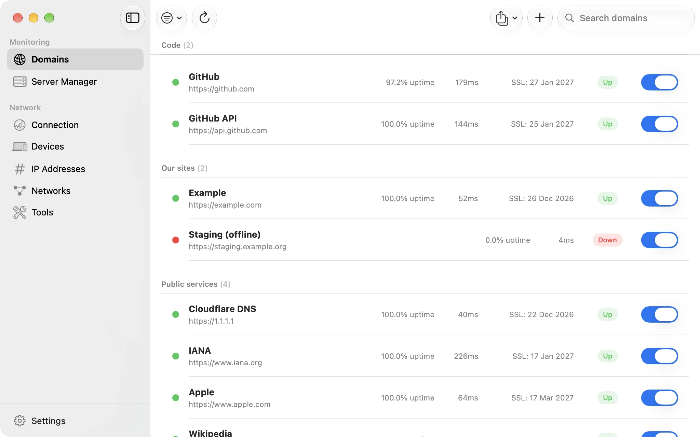

# SignalBar

A native macOS menu bar app that watches your websites and servers: uptime, SSL and domain
expiry, and remote Linux servers over SSH. Built to run all day in the background at near-zero
idle cost.

<picture><source media="(prefers-color-scheme: dark)" srcset="docs/screenshots/domains-dark.webp"></picture>

## Features

- **HTTP health checks**: status code, response time and optional response-body assertions, on
  a configurable interval per target.
- **SSL certificate expiry**: checked through the system trust store, with alerts as expiry
  approaches.
- **Domain expiry**: resolved through RDAP over HTTPS where the TLD supports it, falling back to
  `whois` otherwise. Some ccTLDs (`.vn`, for example) don't publish it through any method.
- **Groups**: targets group by root domain (subdomains fold under it), with drag-and-drop
  reordering of targets and groups and inline renaming.
- **Pause and resume**: snooze a target for 30 minutes, 1, 4 or 24 hours, or indefinitely.
- **Server Manager**: manage remote Linux servers over SSH, including systemd services, nginx
  config and reload, log tailing and live CPU, RAM and disk stats. Every action is allowlisted
  per server (no free-form shell), host keys are pinned on first contact, credentials stay in
  the Keychain, and every action is written to an audit log. One action can run across several
  servers at once.
- **Remote resource alerts**: get alerted when a server's CPU, RAM or disk crosses a threshold.
- **Network**: which device holds which IP address, across the subnets and VLANs you manage.
  Scans the Mac's own subnet directly (devices that block ping included), pings routed subnets,
  reads routers and switches over SNMP (v2c, or v3 with SHA-2 and AES) for the ARP and MAC
  tables of every VLAN, and DHCP leases from MikroTik, from dnsmasq, ISC dhcpd or Kea over SSH,
  or from a file. A device list with IP history, an address map per subnet, interface traffic,
  on-demand TCP port checks, and alerts for new devices, watched devices leaving or coming back,
  and IP conflicts. See [Network](#network) below.
- **Connection**: how this Mac reaches the internet. Public IPv4 and IPv6 with the provider and
  country, double NAT and carrier-grade NAT, the local addresses and DHCP lease, Wi-Fi signal,
  channel and standard, the DNS servers in use and how fast they answer, VPN tunnels and proxies,
  and live latency to the router, the provider and the internet, with a history of public
  addresses and an optional alert when it changes.
- **Response-time percentiles**: p50 and p95 beside every latency chart, over successful checks
  only.
- **Alerts and reports**: native notifications that open the right screen, webhooks (Slack,
  Discord or plain JSON) posted straight from this Mac, and scheduled email reports (see below).
- **Import and export** domains and servers as JSON. Server exports never include credentials.
- **Menu bar panel**: how many domains are up, the ones that are down with the reason, one click
  to open each; the icon turns into a red triangle while one is down.
- Launch at login, light and dark appearance, English and Vietnamese.

The Mac's own stats, the list of running apps, Cleanup and the temperature and battery alerts
moved to [EasyDock](https://github.com/dangkhoabach/EasyDock) in 2.2.1, which imports the
scheduled cleanup and alert settings from SignalBar. The performance overlay was removed.

## Requirements

macOS 14 or later.

## Install

Download the latest version from
[apps.dangkhoabach.vn/dkb-monitor](https://apps.dangkhoabach.vn/dkb-monitor).

The app is not signed with an Apple Developer ID, so macOS blocks the first launch. Open it
once from **System Settings → Privacy & Security → Open Anyway**. Updates then arrive through
**Check for Updates…** ([Sparkle](https://sparkle-project.org/), signed with EdDSA).

SignalBar was called DKB Monitor up to version 2.1.3. It is the same app with the same bundle
identifier, so an installed copy keeps its targets, settings and updates.

### Email reports

Daily, weekly or monthly reports go through a small relay at `api.dangkhoabach.vn`, so there is
no SMTP account to configure. The relay sends only to an address this Mac has verified with a
one-time code, rate-limits every caller, and the token that proves the verification lives in the
macOS Keychain. The recipient address and your domain names are sent to that server to build
the mail. Everything else (checks, webhooks, SSH) goes straight from your Mac.

### Network

Network is read only: SignalBar never changes anything on a router, switch or DHCP server, and
sends nothing about your network anywhere unless you turn on Network alerts for the webhook.
Only subnets you add are scanned, and only private address ranges can be added.

- **Connection lookups.** To find the public address, SignalBar asks Cloudflare's
  `1.1.1.1/cdn-cgi/trace` (OpenDNS's `myip.opendns.com` when Cloudflare can't be reached), asks
  RIPEstat which network the address belongs to, and looks up `whoami.akamai.net` to see which
  DNS resolver answers for the Mac. That is done when the app starts, when the Mac changes
  networks and every 10 minutes; turn it off in Settings › Network and none of them is asked.
  Each refresh also pings 1.1.1.1, traces the first three hops towards it and times one lookup
  of `www.apple.com` at each DNS server in use. Live latency (pings to the router, the
  provider's first hop and 1.1.1.1) is measured only while the Connection page is open.
- **Wi-Fi name.** macOS gives the Wi-Fi network's name only to apps with Location access, so
  the Connection page asks for it only when you click to show the name. SignalBar never reads
  the Mac's location.

- **Local Network permission.** macOS asks once whether SignalBar may reach devices on your
  network. Until it is allowed, scans of the Mac's own subnet find nothing and say so. Because
  the app is not signed with a Developer ID, macOS may ask again after an update.
- **What a scan sends.** On the Mac's own subnet, a few empty UDP datagrams per address (each
  makes macOS send an ARP request) and one ping; on other subnets, a ping and, for silent
  addresses, a TCP connection attempt to a few common ports. Sends are paced at 200 a second.
  On switches that limit ARP traffic per port, turn scanning off for that subnet and read the
  router over SNMP instead.
- **MAC addresses.** macOS doesn't give apps the MAC addresses of other devices, so devices
  found by scanning are listed by IP address. Add the router over SNMP, or a DHCP source, to
  see their MAC addresses and manufacturers.
- **Credentials** for SNMP and routers are kept in the Keychain. A DHCP server read over SSH
  uses a server from the Server Manager; its lease file is added to that server's allowlist.
- Manufacturer names come from the IEEE registry bundled with the app
  (`scripts/update-oui.sh`), never from an online lookup.

## How it works

- **`SignalBarCore`** (Swift package: Foundation, GRDB and the SSH stack, no AppKit): targets,
  the check scheduler, SSL and domain checks, alerts and reports, remote server actions, the
  Network scanner, SNMP client and DHCP readers, SQLite storage. It is tested headless.
- **`SignalBarApp`** (SwiftUI and AppKit): the windows, the menu bar panel, notifications, login
  item and Sparkle.
- SSH runs on [Citadel](https://github.com/orlandos-nl/Citadel) and SwiftNIO. Citadel depends on
  a fork of `swift-nio-ssh` (`Wellz26/swift-nio-ssh`); `Package.swift` declares the same fork at
  an exact version so the reviewed revision is the one every build uses.

The first version was built with Tauri and React; it was rewritten in Swift in 2026 and reads
the same database, so the upgrade kept every target.

## Build from source

Requirements: Xcode 26 or later.

```zsh
open SignalBar.xcodeproj
```

The app target uses automatic signing with no team, so a local build is ad-hoc signed. Run the
`SignalBarApp` scheme.

Tests:

```zsh
cd SignalBarCore && swift test   # 308 tests
xcodebuild test -project SignalBar.xcodeproj -scheme SignalBarApp -destination 'platform=macOS'   # 54 tests
```

Releases are built, signed and published by hand: see [docs/release.md](docs/release.md).

## Forking

Change these before you ship your own build:

- `PRODUCT_BUNDLE_IDENTIFIER` in the Xcode project.
- `SUFeedURL` and `SUPublicEDKey` in `SignalBarApp/Info.plist` (generate your own key with
  Sparkle's `generate_keys`).
- The Keychain services in `SignalBarCore/Sources/SignalBarCore/Data/KeychainStore.swift`.
- `EmailReportSender.baseURL`: point it at your own relay, or leave email reports off. The relay
  at `api.dangkhoabach.vn` serves the official app.

## Security

Please report vulnerabilities privately, as described in [SECURITY.md](SECURITY.md).

## Contributing

Issues are welcome. This is a personal project, so pull requests are read but may not be
merged.

## License

[MIT](LICENSE) for the source code. The SignalBar name, app icon and logo are not covered by
the license; use your own for a fork.
