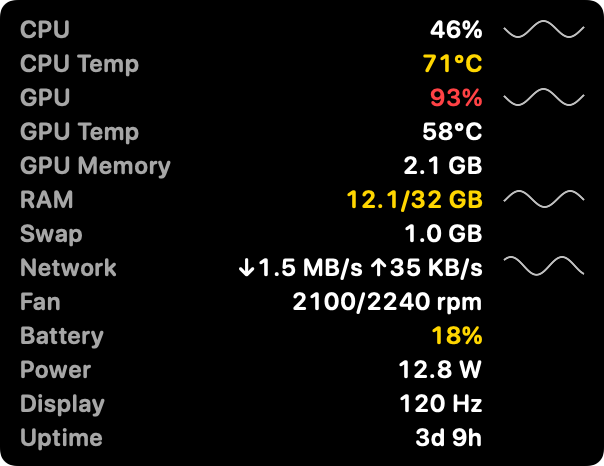

# DKB Monitor

A personal, native macOS menu-bar app for monitoring the uptime, SSL certificate expiry, and domain expiry of websites and APIs, plus live system stats — built to run continuously in the background at near-zero idle cost.

## Features

- **HTTP health checks** — status code, response time, and optional response-body assertions on a configurable interval per target.
- **SSL certificate expiry** — checked via the system trust store, with alerts as expiry approaches.
- **Domain (WHOIS/RDAP) expiry** — resolved via RDAP-over-HTTPS where the TLD supports it, falling back to `whois` otherwise. Some ccTLDs (e.g. `.vn`) don't expose this publicly through any method.
- **Live system stats** — CPU, memory, swap, temperature (SMC), battery, and network, refreshed continuously and surfaced both in a System tab and the menu bar dropdown, with alerts for high temperature/low battery.
- **Performance overlay** — an optional always-on-top panel in a screen corner with live CPU, GPU, RAM, temperatures, fans, network, battery, power and display refresh rate, like MSI Afterburner's on-screen display. Clicks pass through it and it never takes focus. It stays on every Space and over full-screen apps, and pauses while the display sleeps or the Mac is locked. Layout, size, background, opacity, refresh rate, which readings to show and their order, sparklines, drag-to-place and a global show/hide shortcut are all in Settings. It costs about 0.8% of one core at a one-second refresh, measured on a Release build. macOS gives no way to count another app's frames, so the overlay shows no FPS. Instead, Settings can switch on Apple's Metal Performance HUD, which draws real FPS inside each game.

   
- **Running Apps** — a Task-Manager-style list of user-facing apps with CPU/memory usage and status, sortable, with Quit/Force Quit.
- **Groups** — targets group by root domain (subdomains fold under it), with drag-and-drop reordering of both targets and groups, and inline group renaming.
- **Pause/resume checks** — snooze a target for 30m/1h/4h/24h or indefinitely.
- **Native macOS integration** — `MenuBarExtra` with live CPU/RAM/uptime summary, native notifications (click-to-navigate), launch-at-login, light/dark theme, in-app language switching (English/Vietnamese).
- **Scheduled email reports** — a daily/weekly/monthly summary of uptime and incidents, delivered through the app's own relay so there is no SMTP account to configure. The relay only sends to an address this Mac has verified with a one-time code, so the endpoint cannot be pointed at anyone else; the token that proves it lives in the macOS Keychain, never in the database.
- **Webhook alerts** — every alert can also go to a Slack, Discord, or plain-JSON webhook, posted straight from this Mac.
- **Server Manager** — manage remote Linux servers over SSH: systemd services, nginx config and reload, log tailing, and live CPU/RAM/disk stats. Every action is allowlisted per server (no free-form shell), host keys are pinned on first contact, and credentials stay in the Keychain. One action can be run across several servers at once.
- **Remote resource alerts** — opt a server into monitoring and get alerted when its CPU, RAM, or disk crosses a threshold.
- **Cleanup** — measure and clear developer and app caches (moved to the Trash, never deleted outright), find large files, and optionally run the selected locations on a daily/weekly/monthly schedule.
- **Response-time percentiles** — p50 and p95 beside every latency chart, computed over successful checks only.
- **Import/export/clear** domains and servers as JSON (server exports never include credentials).

## Tech stack

- **Swift 6 + SwiftUI**, targeting macOS 14+.
- **`DKBMonitorCore`** — a headless Swift package (Foundation + GRDB only, no AppKit) holding the domain logic: target CRUD, the HTTP/SSL/domain check scheduler, alert/report generation, and SQLite storage via [GRDB](https://github.com/groue/GRDB.swift).
- **`DKBMonitorApp`** — the app target: SwiftUI views, `MenuBarExtra`, AppKit-only system integration (SMC temperature/fan reads via IOKit, process list via `libproc`, login item, notifications), and [Sparkle](https://sparkle-project.org/) for auto-updates.
- **`DKBMonitorNative.xcodeproj`** — committed as-is (only `project.pbxproj` is tracked); targets, deps and `Info.plist` are edited in Xcode.

## Project structure

```
DKBMonitorNative.xcodeproj/          Xcode project (targets, deps, Sparkle pin)
DKBMonitorApp/
  Info.plist                          version (source of truth for release.sh), Sparkle feed URL + public key
  App/                                App/Scene setup, window management, Sparkle updater, login item
  UI/                                 SwiftUI views + view models (Overview, System, Settings, Target detail)
  Overlay/                            always-on-top performance overlay: panel, window controller, view, global shortcut
  System/                             SMC reader, GPU stats (IOKit), process list (libproc), system stats service
  Notifications/                      UNUserNotificationCenter wrapper, click-to-navigate routing
DKBMonitorCore/
  Sources/DKBMonitorCore/
    Domain/                           Scheduler, HttpChecker, ExpiryChecker, EmailReportSender, ReportGenerator,
                                      RemoteCommandExecutor + SSHCommandRunner (SSH), AlertWebhook, RemoteResourceAlerts
    Data/                             AppDatabase (GRDB), TargetRepository, SettingsRepository, RemoteServerRepository, KeychainStore
    Models/                           Target, TargetOverview, Incident, CheckResult, ExpiryStatus, RemoteServer
    System/                           Cross-platform-safe stats/process value types
  Tests/                              swift-testing suite for DKBMonitorCore
docs/
  swift-native-port-plan.md           full history of the Tauri → native port
  release.md                          local build/sign/publish process (ad-hoc signed, not notarized)
  overlay-hud-plan.md                 performance overlay: design, measurements, phase checklists
scripts/
  release.sh                          tests, builds, ad-hoc signs, DMGs, and Sparkle-signs a release
```

## Getting started

```bash
open DKBMonitorNative.xcodeproj
```

Run the `DKBMonitorApp` scheme from Xcode (choose your signing team under Signing & Capabilities first). `DKBMonitorCore` can also be tested headlessly:

```bash
cd DKBMonitorCore
swift test
```

## Releasing (Check for Updates)

Sparkle reads `SUFeedURL`/`SUPublicEDKey` from `DKBMonitorApp/Info.plist`. `SUFeedURL` points at `updates.dangkhoabach.vn` (the same domain the old Tauri app's updater used) — not GitHub Releases, which this project doesn't publish to.

Releases are built, ad-hoc signed, and uploaded entirely from this machine — no CI, no paid Apple Developer Program membership (so no notarization; first launch needs right-click → Open, same as the old Tauri build). Run `./scripts/release.sh`, then upload the resulting DMG + `.sig` via admin.dangkhoabach.vn's web UI. See `docs/release.md` for details.
