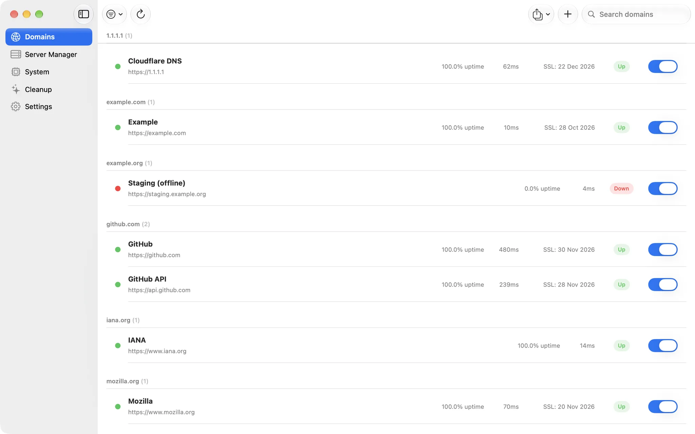

# SignalBar

A native macOS menu bar app that watches your websites and servers and your own Mac: uptime,
SSL and domain expiry, live system stats, a performance overlay and remote Linux servers over
SSH. Built to run all day in the background at near-zero idle cost.

<picture><source media="(prefers-color-scheme: dark)" srcset="docs/screenshots/domains-dark.webp"></picture>

## Features

- **HTTP health checks**: status code, response time and optional response-body assertions, on
  a configurable interval per target.
- **SSL certificate expiry**: checked through the system trust store, with alerts as expiry
  approaches.
- **Domain expiry**: resolved through RDAP over HTTPS where the TLD supports it, falling back to
  `whois` otherwise. Some ccTLDs (`.vn`, for example) don't publish it through any method.
- **Live system stats**: CPU per core, GPU, memory and swap, temperatures and fans (SMC),
  battery, storage and network, in a System pane and the menu bar, with alerts for high
  temperature and low battery.
- **Performance overlay**: an optional always-on-top panel in a screen corner with live CPU,
  GPU, RAM, temperatures, fans, network, battery, power and display refresh rate, like MSI
  Afterburner's on-screen display. Clicks pass through it and it never takes focus. It stays on
  every Space and over full-screen apps, and pauses while the display sleeps or the Mac is
  locked. Layout, size, background, opacity, refresh rate, which readings to show and their
  order, sparklines, drag-to-place and a global show/hide shortcut are all in Settings. It costs
  about 0.8% of one core at a one-second refresh, measured on a Release build. macOS gives no
  way to count another app's frames, so the overlay shows no FPS; Settings can switch on Apple's
  Metal Performance HUD instead, which draws real FPS inside each game.

   
- **Running apps**: a Task Manager-style list of apps with CPU and memory use, sortable, with
  Quit and Force Quit.
- **Groups**: targets group by root domain (subdomains fold under it), with drag-and-drop
  reordering of targets and groups and inline renaming.
- **Pause and resume**: snooze a target for 30 minutes, 1, 4 or 24 hours, or indefinitely.
- **Server Manager**: manage remote Linux servers over SSH, including systemd services, nginx
  config and reload, log tailing and live CPU, RAM and disk stats. Every action is allowlisted
  per server (no free-form shell), host keys are pinned on first contact, credentials stay in
  the Keychain, and every action is written to an audit log. One action can run across several
  servers at once.
- **Remote resource alerts**: get alerted when a server's CPU, RAM or disk crosses a threshold.
- **Cleanup**: measure and clear developer and app caches (moved to the Trash, never deleted
  outright), find large files, and optionally run it on a schedule.
- **Response-time percentiles**: p50 and p95 beside every latency chart, over successful checks
  only.
- **Alerts and reports**: native notifications that open the right screen, webhooks (Slack,
  Discord or plain JSON) posted straight from this Mac, and scheduled email reports (see below).
- **Import and export** domains and servers as JSON. Server exports never include credentials.
- Launch at login, light and dark appearance, English and Vietnamese.

## Requirements

macOS 14 or later.

## Install

Download the latest version from
[apps.dangkhoabach.vn/dkb-monitor](https://apps.dangkhoabach.vn/dkb-monitor).

The app is not signed with an Apple Developer ID, so macOS blocks the first launch. Open it
once from **System Settings → Privacy & Security → Open Anyway**. Updates then arrive through
**Check for Updates…** ([Sparkle](https://sparkle-project.org/), signed with EdDSA).

SignalBar was called DKB Monitor up to version 2.1.3. It is the same app with the same bundle
identifier, so an installed copy keeps its targets, settings and updates.

### Email reports

Daily, weekly or monthly reports go through a small relay at `api.dangkhoabach.vn`, so there is
no SMTP account to configure. The relay sends only to an address this Mac has verified with a
one-time code, rate-limits every caller, and the token that proves the verification lives in the
macOS Keychain. The recipient address and your domain names are sent to that server to build
the mail. Everything else (checks, webhooks, SSH) goes straight from your Mac.

## How it works

- **`SignalBarCore`** (Swift package: Foundation, GRDB and the SSH stack, no AppKit): targets,
  the check scheduler, SSL and domain checks, alerts and reports, remote server actions, SQLite
  storage. It is tested headless.
- **`SignalBarApp`** (SwiftUI and AppKit): the windows, `MenuBarExtra`, the overlay, SMC and GPU
  readings through IOKit, the process list through `libproc`, notifications, login item and
  Sparkle.
- SSH runs on [Citadel](https://github.com/orlandos-nl/Citadel) and SwiftNIO. Citadel depends on
  a fork of `swift-nio-ssh` (`Wellz26/swift-nio-ssh`); `Package.swift` declares the same fork at
  an exact version so the reviewed revision is the one every build uses.
- Temperatures and fans come from the SMC with the same technique smcFanControl and SMCKit use;
  there is no public Apple API for them.

The first version was built with Tauri and React; it was rewritten in Swift in 2026 and reads
the same database, so the upgrade kept every target.

## Build from source

Requirements: Xcode 26 or later.

```zsh
open SignalBar.xcodeproj
```

The app target uses automatic signing with no team, so a local build is ad-hoc signed. Run the
`SignalBarApp` scheme.

Tests:

```zsh
cd SignalBarCore && swift test   # 311 tests
xcodebuild test -project SignalBar.xcodeproj -scheme SignalBarApp -destination 'platform=macOS'   # 74 tests
```

Releases are built, signed and published by hand: see [docs/release.md](docs/release.md).

## Forking

Change these before you ship your own build:

- `PRODUCT_BUNDLE_IDENTIFIER` in the Xcode project.
- `SUFeedURL` and `SUPublicEDKey` in `SignalBarApp/Info.plist` (generate your own key with
  Sparkle's `generate_keys`).
- The Keychain services in `SignalBarCore/Sources/SignalBarCore/Data/KeychainStore.swift`.
- `EmailReportSender.baseURL`: point it at your own relay, or leave email reports off. The relay
  at `api.dangkhoabach.vn` serves the official app.

## Security

Please report vulnerabilities privately, as described in [SECURITY.md](SECURITY.md).

## Contributing

Issues are welcome. This is a personal project, so pull requests are read but may not be
merged.

## License

[MIT](LICENSE) for the source code. The SignalBar name, app icon and logo are not covered by
the license; use your own for a fork.
